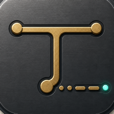
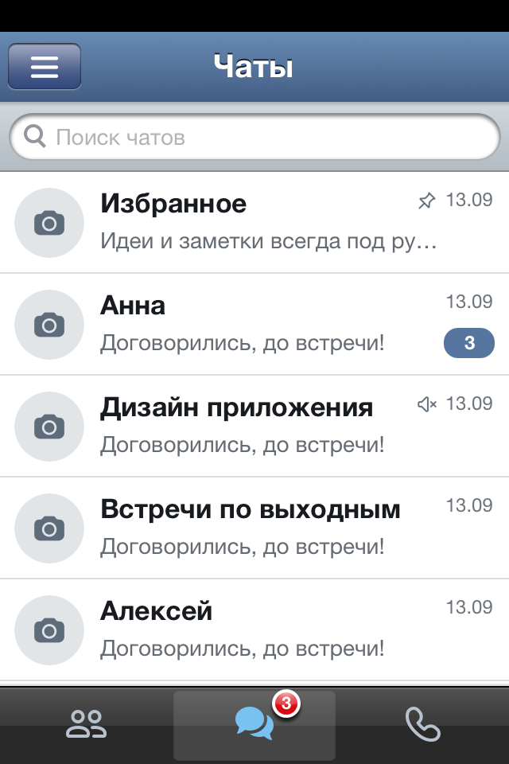
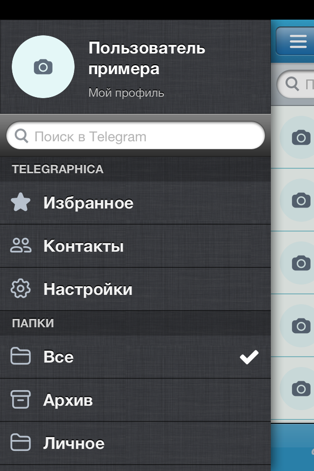
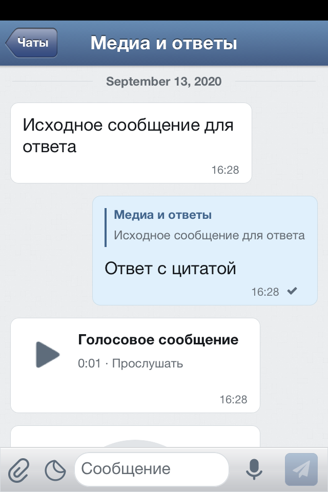

# MiChiRose — репозиторий Cydia

Личный репозиторий приложений, твиков и утилит для iOS с jailbreak.
В Cydia источник отображается как **MiChiRose**; совместимость и зависимости
определяются отдельно для каждого пакета.

**Адрес источника:** <https://michirose.github.io/cydia/>

Если раньше был добавлен источник `/telegraphica-cydia/`, удалите старую запись
из списка источников Cydia и добавьте новый адрес выше. Удалять установленные
приложения и твики не нужно.

## Доступные пакеты

- **[MiChiRose Weather (Alpha)](https://michirose.github.io/cydia/depictions/weather/)** —
  экспериментальное исправление штатной «Погоды» на iOS 6 с прямым доступом
  к Open-Meteo. Alpha 3 включает приложение **Weather Check** для проверки
  HTTPS, загрузчика и геопозиции без терминала. Перед установкой удалить WeatherX. Физическая проверка на
  iPhone 4s / iOS 6.1.3 пока не выполнена; геолокация в эту alpha не входит.
- **Telegraphica** — неофициальный клиент Telegram для iOS 6 / ARMv7.
- **Telegraphica Background** — фоновая служба, устанавливаемая вместе с Telegraphica.

Новые твики и утилиты будут добавляться в этот же источник.

---

<p align="center">
  
</p>

<h2 align="center">Telegraphica для iOS 6</h2>

<p align="center">
  Telegram в духе классического iPhone.<br>
  Фактурные темы, привычная переписка и новая жизнь любимого устройства.
</p>

<p align="center"><strong>Бета 1 · Сборка 39 · Jailbreak + AppSync</strong></p>

<p align="center">
  <a href="https://michirose.github.io/cydia/"><strong>Источник Cydia</strong></a>
  &nbsp;·&nbsp;
  <a href="https://github.com/MiChiRose/cydia/releases/download/ios6-v0.1.0-beta1-39/Telegraphica-0.1.0-beta1-build39-ios6-armv7.ipa"><strong>Скачать IPA</strong></a>
  &nbsp;·&nbsp;
  <a href="https://github.com/MiChiRose/cydia/releases/tag/ios6-v0.1.0-beta1-39">Все файлы релиза</a>
</p>

---

<table>
  <tr>
    <td align="center" width="33%"></td>
    <td align="center" width="33%"></td>
    <td align="center" width="33%"></td>
  </tr>
  <tr>
    <td align="center"><strong>Знакомые чаты</strong></td>
    <td align="center"><strong>Папки под рукой</strong></td>
    <td align="center"><strong>Больше, чем текст</strong></td>
  </tr>
</table>

<p align="center"><sub>Демонстрационные экраны с вымышленными данными. Личная переписка для иллюстраций не использовалась.</sub></p>

## Что умеет Telegraphica

- **Переписка:** личные диалоги, группы, папки и темы форумов.
- **Медиа:** фотографии, файлы, голосовые сообщения и видеокружки.
- **Общение:** ответы с цитатой, стикеры и обычные реакции.
- **Оформление:** классические темы и Aqua, вдохновлённые Telegraphica для Mac.
- **Уведомления:** фоновая служба для устройства с jailbreak.

Telegraphica — неофициальный клиент Telegram. Это первая публичная бета; ограничения перечислены ниже.

**Сборка 39 — новая иконка:** вязаный самолётик теперь используется на домашнем экране, в системных уведомлениях, на экранах входа, загрузки и настроек. В Cydia выберите **Telegraphica 0.1.0~beta1-39**. Фоновая служба остаётся **0.1.0-25**. Обновляйте поверх установленного приложения; вход и данные контейнера не удаляются. Установку и запуск предыдущей 38.5 через Cydia владелец подтвердил; внешний вид новой сборки ещё проверяется на телефоне.

## Перед установкой

| Что нужно | Подробности |
| --- | --- |
| **iOS 6 и ARMv7** | Проверено на **iPhone 4s с iOS 6.1.3**. Другие сочетания устройств и версий пока не проверялись. |
| **Jailbreak** | Эта сборка не поддерживает обычную iOS без jailbreak. |
| **AppSync Unified для iOS 6** | Должен быть установлен или доступен из вашего доверенного источника Cydia. Здесь AppSync не распространяется; [проект AppSync](https://github.com/akemin-dayo/AppSync). |

## Установка через Cydia

**Все шаги выполняются на iPhone. Терминал и компьютер не нужны.**

1. Откройте **Cydia → Управление → Источники → Изменить → Добавить**.
2. Вставьте адрес источника:

   ```text
   https://michirose.github.io/cydia/
   ```

3. Дождитесь обновления списка пакетов и откройте добавленный источник.
4. Выберите **Telegraphica** и нажмите **Установить → Подтвердить**.
5. Откройте приложение и войдите в свой Telegram. Доступен QR-вход через Telegram на другом устройстве.

**Telegraphica Background установится автоматически** как зависимость полного приложения. Отдельно настраивать службу не требуется.

> Источник уже добавлен по новому адресу? Просто обновите список пакетов. Выбирайте **Telegraphica**, а не только **Telegraphica Background** — это полное приложение.

## IPA и другие загрузки

| Скачать | Для чего |
| --- | --- |
| **[IPA для iOS 6](https://github.com/MiChiRose/cydia/releases/download/ios6-v0.1.0-beta1-39/Telegraphica-0.1.0-beta1-build39-ios6-armv7.ipa)** | Для совместимого jailbreak-установщика IPA с AppSync. |
| **[Все файлы релиза](https://github.com/MiChiRose/cydia/releases/tag/ios6-v0.1.0-beta1-39)** | Полный DEB, IPA, инструкция и контрольные суммы SHA-256. |

Загрузка IPA в Safari сама по себе **не устанавливает приложение**. Для обычной установки используйте Cydia по шагам выше.

## Обновление без потери входа

Обновления появляются в Cydia. **Не удаляйте прежнее приложение перед обновлением:** удаление иконки с домашнего экрана может стереть его локальные данные.

Обновление на iPhone 4s / iOS 6.1.3 проверено: вход и диалоги сохранились. Удаление установочного пакета из Cydia сохраняет приложение и аккаунт; удаление приложения с домашнего экрана — отдельное действие.

## Что пока ограничено

- Настоящие аудио- и видеозвонки ещё не реализованы.
- Встроенных настроек прокси пока нет; поиск музыки имеет известные проблемы.
- Фоновые уведомления используют jailbreak-службу; длительный расход батареи ещё проверяется.
- Чистая установка на другом физическом устройстве и другие ARMv7-устройства пока не проверялись.
- iOS 7 и более новые системы этой бета-сборкой не поддерживаются.

## Ваш аккаунт остаётся вашим

В загрузках **нет чужой сессии, переписки, контактов, кэша и ключей базы данных**. Каждый пользователь самостоятельно входит в свой аккаунт. Конфигурация приложения получается по HTTPS; локальные конфигурационные файлы разработчика, ключи подписи и профили в пакеты не включены.

Публичный репозиторий содержит страницу проекта, иллюстрации и установочные файлы. Исходники приложения хранятся отдельно.

<details>
<summary><strong>English installation guide</strong></summary>

Telegraphica is an unofficial Telegram client for **jailbroken iOS 6 / ARMv7** devices with a classic iPhone interface. Tested on **iPhone 4s / iOS 6.1.3**.

1. Install or make available **AppSync Unified compatible with iOS 6** from your trusted package source.
2. Open **Cydia → Manage → Sources → Edit → Add**.
3. Add **https://michirose.github.io/cydia/** and refresh.
4. Install **Telegraphica**, the full application. The companion installs automatically; no terminal or development Mac is needed.
5. Open the app and sign in to your own Telegram account. QR login uses Telegram on another device.

The [IPA](https://github.com/MiChiRose/cydia/releases/download/ios6-v0.1.0-beta1-39/Telegraphica-0.1.0-beta1-build39-ios6-armv7.ipa) requires a compatible jailbreak IPA installer with AppSync. Downloading it in Safari alone does not install it. Stock iOS is unsupported.

Do not delete an existing app before updating. The tested upgrade preserved login and dialogs; a fresh physical installation and other devices have not yet been checked. Real calls and proxy settings are not implemented, Music search has known issues, and background battery behavior remains experimental.

</details>

<details>
<summary><strong>Контрольные суммы и обратная связь</strong></summary>

`SHA256SUMS` в [релизе](https://github.com/MiChiRose/cydia/releases/tag/ios6-v0.1.0-beta1-39) проверяет установочные файлы. [SHA256SUMS источника](https://michirose.github.io/cydia/SHA256SUMS) относится к странице, индексам Cydia и сохранённым загрузкам. Индексы пока без отдельной подписи APT; используйте HTTPS без отключения проверки сертификатов.

Чтобы сообщить о проблеме, укажите сборку, модель устройства, версию iOS, шаги воспроизведения и текст ошибки. Не отправляйте переписку, номера телефонов, коды входа или пароли.

</details>
